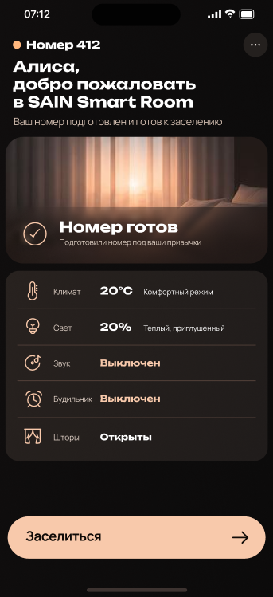
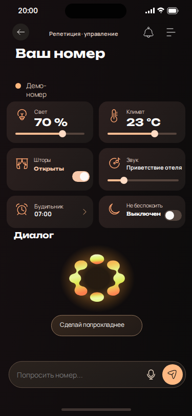

# SAIN Smart Room · 4Sain

**Номер, который знает гостя.** Персональный сценарий проживания, управление шестью системами номера и контекстный диалог — в одном интерфейсе.

Независимый fullstack-прототип команды **4Sain** для кейса №2 хакатона **SAIN × Школа 21 «Точка входа»**, доработанный после конкурса. **Не является официальным продуктом SAIN.** В автономном режиме устройства — программный симулятор.

| Мобильный номер | Диалог |
|:---:|:---:|
|  |  |

**[Figma · 29 экранов](https://www.figma.com/design/z5s6MFxKIDC6P9ECm4CbuO/4SAIN?node-id=0-1&p=f&t=0IT5kqCK4JA5mGU4-0)** · **[Windows ZIP](https://github.com/nikamurkaa/sain-hack-2026-4Sain/actions/runs/45254804178/artifacts/14855564345)** · **[macOS ZIP](https://github.com/nikamurkaa/sain-hack-2026-4Sain/actions/runs/45254804079/artifacts/14858781298)** · **[Технический handoff](docs/release/FINAL_TECHNICAL_HANDOFF.md)**

## Возможности

- **Персональный план:** профиль, предпочтения, расписание на утро/день/вечер/ночь, восемь правил сна **R1–R8** и объяснение выбора настроек.
- **6 систем номера:** климат, свет, звук, шторы, будильник и «Не беспокоить»; результат в интерфейсе появляется **только после подтверждения симулятора**.
- **Диалог и контекст:** 19 категорий намерений, «Сделай попрохладнее» → «Ещё немного», отказ на недопустимые значения, сохранённая история.
- **Надёжность:** изоляция гостей, идемпотентность, запрет слепых повторов; **SQLite WAL** восстанавливает автономные сеансы, подтверждённые настройки, историю и журнал операций после перезапуска.
- **UX:** мобильная и desktop-версии на React/TypeScript по 29 экранам Figma; виртуальное время и «Продолжение дома» — экспорт *синтетических* настроек для следующего заезда.
- **Голос/AI-ready:** клиент с записью, подтверждением расшифровки и воспроизведением ответа; интеграционные адаптеры LLM/STT/TTS. offline-режим использует FakeLLM.

**Стек:** Python 3.11 · FastAPI · React · TypeScript · Vite · SQLite · pytest · Playwright · GitHub Actions.

**Проверено в финальном техническом PR:** 487 Python-тестов, 21 Node-тест, 58 E2E в Chromium и 58 в Firefox; нативные CI-сборки/запуски Windows и macOS ARM64. Это подтверждение **автономного scope**.

## Запуск · Windows / macOS

Готовые ZIP содержат собранный frontend, **Node.js не нужен**. Требуются Python 3.11+ и интернет для первичной установки Python-зависимостей. Распакуйте пакет в отдельную папку. Обе платформы используют порты **4173** и **8765**.

| Windows | macOS |
|---|---|
| [Скачать ZIP](https://github.com/nikamurkaa/sain-hack-2026-4Sain/actions/runs/45254804178/artifacts/14855564345) | [Скачать ZIP](https://github.com/nikamurkaa/sain-hack-2026-4Sain/actions/runs/45254804079/artifacts/14858781298) |
| `CHECK_ENV.cmd`, затем `START.cmd` → **1 REHEARSAL** | В Terminal: `bash CHECK_ENV.command && bash START.command` |
| Гостевой токен: `.venv\Scripts\python.exe -m scripts.client_access dev --stay stay_test` | Гостевой токен: `.venv/bin/python -m scripts.client_access dev --stay stay_test` |
| Остановить: `STOP.cmd` | Остановить: `bash STOP.command` |

В браузере откройте **http://127.0.0.1:4173**, введите **только локальный гостевой токен** и нажмите «Подключиться» → «Заселиться». После перезапуска автономного backend введите **тот же токен**: данные SQLite восстанавливаются; браузер не хранит токен в localStorage. Локальную папку `.sain-state/` не публикуйте.

**Из исходников / серверный стенд:** Python 3.11, `python -m pip install -r requirements.txt`, затем **`bash start.sh`** (FastAPI на порту `PORT`, по умолчанию 8000; `POST /run`). Frontend для локального просмотра: `cd frontend && npm ci && npm run build`, далее см. [инструкцию](frontend/README.md). Готовый ZIP быстрее для демонстрации.

## Реальный AI, официальный API и DEV

**REHEARSAL**, **LIVE AI** и **официальный DEV** — разные режимы. Исторические конкурсные ключи истекли. Реальные API требуют **новых credentials, действующего разрешения и доступной сети**. Никогда не вводите командный/LLM-ключ в браузер и не публикуйте их в GitHub, ZIP, скриншотах или логах.

- **LIVE AI + локальный симулятор:** установите серверные переменные `LLM_API_KEY`, `LLM_MODEL`, `LLM_BASE_URL` от авторизованного провайдера. Windows: `START.cmd` → **3 LIVE AI** (ключ можно ввести в скрытом запросе). macOS: `SAIN_MODE=live bash START.command`. Это **не** подключение к физическому номеру и не доказанный реальный AI E2E.
- **Официальный backend:** `bash start.sh` запускает `main:app` и маршрут `POST /run` по контракту кейса №2: `case=2`, `dataset_code`, bearer-токен, получение набора через `GET /case/2/getData`, ответы и действия через разрешённый API симулятора. **Не инициируйте закрытый /run вручную и не повторяйте зачётные прогоны.**
- **Один авторизованный DEV-прогон:** на машине с сетевым доступом установите `HACK_TEAM_TOKEN`, `LLM_API_KEY`, `LLM_MODEL` (при необходимости `HACK_API_URL` и `LLM_BASE_URL`), затем выполните **`python -m scripts.stage3_provider_probe`**. Скрипт *создаёт реальный DEV-run*, может обратиться к платной модели и проверить chat/STT/TTS; это **не dry-run**. Без доступа статусы остаются NOT TESTED.
- **Альтернативный полный DEV-харнесс:** `python -m scripts.check_dev --with-model` — **вместо**, а не после предыдущего прогона. `POST /case/2/validate` может вернуть **501**: это неподдерживаемая сервером проверка, не PASS.

Детали схем, авторизации и безопасной сверки: [Client API](docs/client-api.md) · [Требования R1–R8 / намерения](docs/requirements-traceability.md) · [Границы приёмки](docs/release/FINAL_TECHNICAL_HANDOFF.md).

## Роли · команда 4Sain

| Участник | Вклад |
|---|---|
| **Женя · Team Lead / UI/UX Designer** | Координация работы команды, продуктовая концепция, пользовательские сценарии, дизайн-система и **29 экранов в Figma** — визуальная основа приложения. |
| **Ника · Backend Developer / AI Integration** | FastAPI, персонализация, обработка команд, API и симулятор, безопасность, SQLite-восстановление, интеграция AI/voice-адаптеров, CI/release; помощь с frontend. |
| **Алексей · Frontend Developer** | React/TypeScript, адаптивные экраны по Figma, интерфейс устройств и диалога, клиентская интеграция с backend API. |
| **Павел · Manual QA** | Ручное тестирование пользовательских сценариев и проверка поведения приложения, обратная связь по обнаруженным проблемам. |

## ИИ · что использовали и что сделали сами

При разработке использовались AI-ассистенты, в том числе ChatGPT, для помощи с вариантами кода, тестами, проверками и документацией; участники команды ставили задачи, принимали инженерные решения, проверяли результат и интегрировали проект. В offline-продукте **FakeLLM** — детерминированная тестовая модель, а `ModelClient` — адаптер для разрешённого нейросетевого прокси. Бизнес-правила, допустимые команды, проверка состояния и изоляция гостей реализованы на сервере; реальная LLM/STT/TTS-интеграция после конкурса не подтверждена.

## Источники

- [Официальное задание кейса №2](docs/requirements-traceability.md), инструкции SAIN × Школа 21 от 16.11.2026, схемы `backend/schemas/`.
- [Оригинальный дизайн 4Sain (Figma)](https://www.figma.com/design/z5s6MFxKIDC6P9ECm4CbuO/4SAIN?node-id=0-1&p=f&t=0IT5kqCK4JA5mGU4-0), ресурсы в `frontend/`.
- Python/JS-зависимости и версии: `requirements*.txt`, `frontend/package*.json`; лицензии шрифтов Manrope/Unbounded/Inter лежат рядом с ресурсами.

## Журнал решений

| Что решили | Зачем |
|---|---|
| Сохранили 29 экранов Figma, реализовали их как React-состояния | Рабочий UX вместо статичных макетов |
| Разделили персональный план и подтверждённое состояние устройств | Не показывать ложный успех |
| Добавили FakeLLM/MockSimulator для REHEARSAL | Демо без истёкших конкурсных ключей |
| Запретили слепые повторы неопределённых POST | Не удваивать действие при сетевых сбоях |
| Внедрили SQLite WAL для **локального** режима | Возобновление сессий и истории после рестарта |
| Подготовили ZIP и нативные Windows/macOS CI | Запуск без ручной сборки фронтенда |

---

**Статус:** автономная техническая версия готова к локальной демонстрации. Реальные модели, официальный API после хакатона и физическое оборудование **не проходили live-приёмку**. Команда открыта к обратной связи и обсуждению возможного пилота после согласования доступа и прав.
