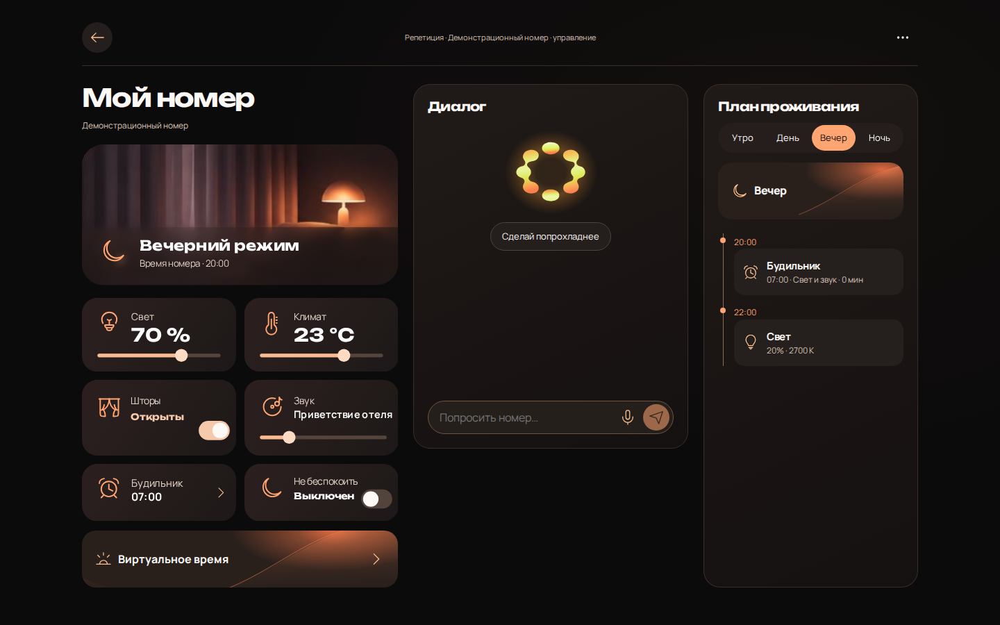

# SAIN Smart Room

**Fullstack-прототип персонализированного умного гостиничного номера** от команды **4Sain** для хакатона **SAIN × Школа 21 «Точка входа»**, кейс №2 «Номер, который знает гостя» (ноябрь 2026).

**Неофициальный проект команды, не продукт SAIN.** Участие завершилось на онлайн-этапе; приложение сохранено для портфолио и локальной демонстрации, а не как работающий production-сервис.

## Экраны

| Мобильный номер · 375×812 | Desktop · 1440×900 |
| --- | --- |
|  |  |

[Мобильный диалог с ассистентом](docs/screenshots/mobile-dialog.png). Это реальные снимки локальной браузерной сборки из Playwright, не обещание работы с реальной гостиницей.

## Что реализовано

- Персонализированный план пребывания: утро, день, вечер и ночь, профиль гостя, правила R1–R8 и сценарии на виртуальное время.
- Шесть систем комнаты: **климат, освещение, звук, шторы, будильник, «Не беспокоить»**. Состояние считается изменённым только после подтверждения симулятора.
- Текстовый диалог с последовательными просьбами, контекстом, историей, проверкой намерений и понятными отказами.
- Валидация параметров и диапазонов, повтор команд с идемпотентностью, разделение dev и final/read-only.
- Адаптивный React-интерфейс на основе оригинальной визуальной концепции команды в Figma: план, комната, настройки, чат, профиль, ошибки.
- Голосовой UI с браузерной записью. В автономной репетиции транскрипт **синтетический**: живая STT-модель для него не вызывается.

## Архитектура и технологии

| Слой | Реализация |
| --- | --- |
| Backend | Python 3.11+, FastAPI, Pydantic, HTTPX |
| Бизнес-логика | Планировщик, предпочтения, R1–R8, намерения и проверка команд |
| AI | Адаптер организаторского LLM-прокси при разрешённом доступе; FakeLLM для автономных тестов |
| Симулятор | MockSimulator и HTTPX MockTransport локально |
| Frontend | React, TypeScript, Vite; Manrope, Unbounded; брендовые SVG и изображения |
| Проверки | pytest, Node unit tests, TypeScript, Playwright Chromium/Firefox, GitHub Actions |
| Развёртывание | localhost-прокси и Windows launcher; Docker не требуется |

Поток данных: браузер → frontend/serve.py → FastAPI → валидируемая команда → симулятор → подтверждённое состояние → обновление React.

## Запуск автономного демо

Требуются **Python 3.11+** и **Node.js 24+**. Официальные токены и доступ к инфраструктуре организаторов **не нужны**.

Установка из корня репозитория:

~~~bash
python -m venv .venv
# Активируйте .venv/bin/activate (Linux/macOS)
# или .venv\Scripts\Activate.ps1 (Windows PowerShell)
python -m pip install -r requirements-dev.txt
cd frontend
npm ci
npm run build
cd ..
~~~

Откройте три терминала из корня проекта с активным Python-окружением:

1. API: **python -m scripts.rehearse_client** — только 127.0.0.1:8765.
2. UI: **cd frontend && python serve.py --mode rehearsal** — адрес http://127.0.0.1:4173.
3. Токен гостя: **python -m scripts.client_access dev --stay stay_test**. Введите выданный временный токен в браузере, затем выполните заселение.

Для read-only просмотра есть **python -m scripts.client_access final**. После перезапуска API создайте новый токен: состояние хранится в памяти процесса. Браузер не сохраняет гостевой токен в localStorage.

### Windows без Node.js

Для просмотра готовой сборки используйте артефакт из GitHub Actions, workflow **Build portable Windows demo**. Извлеките ZIP полностью, запустите **CHECK_ENV.cmd** и **START.cmd → 1 (REHEARSAL)**. Нужен Python 3.11+, первый запуск может скачивать зависимости. Подробности — [руководство Windows](docs/WINDOWS_ACCEPTANCE_GUIDE_RU.md).

Папка frontend/dist не хранится в Git: она генерируется Vite и включается в собираемый ZIP.

## Тестирование

~~~bash
python -m pytest -q
python -m scripts.check_offline
cd frontend
npm ci
npm test
npm run build
npx playwright install --with-deps chromium firefox
npm run e2e
SAIN_BROWSER=firefox npm run e2e
~~~

Vite build включает проверку TypeScript. В Playwright используется локальный сервер; тестируются 12 треков × 10 разрешений, 100 сообщений, управление, ошибки и read-only режим. Автономный /run использует **синтетические 10 заездов и 60 просьб**: эти результаты не являются официальной оценкой жюри.

## Безопасность и ограничения

- .env и реальные ключи не публикуются; см. [.env.example](.env.example).
- **REHEARSAL** целиком локален (MockSimulator/FakeLLM). **STAND** допускается только с действующими официально выданными правами; общедоступного STAND нет.
- Закрытый официальный final после /run может быть read-only (HTTP 409). Не предусмотрен обход ограничений.
- Живые LLM/STT, физический Windows-запуск и production deployment не подтверждаются этим демо.
- Лицензии сторонних шрифтов сохранены в frontend/public/media. Использование бренда SAIN и отдельных ресурсов хакатона регулируется правообладателями; публичность репозитория не означает разрешение на любое использование.

## Структура

~~~text
backend/               Доменные модели, сценарии, намерения, клиенты API
backend/schemas/       Контракт кейса №2
main.py                FastAPI и маршруты сеансов
frontend/src/          React/TypeScript и дизайн-система
frontend/public/media/ Изображения, SVG, локальные шрифты и лицензии
frontend/tests/        Unit, E2E, responsive и visual checks
tests/                 Backend, API, безопасность, R1–R8 и offline 10/60
scripts/               Автономный запуск, диагностика, пакет Windows
windows/               START/STOP и PowerShell launcher
docs/                  Решения, API, матрица требований, инструкции
.github/workflows/     CI без автоматического production deployment
~~~

## Команда и статус

Проект создан командой **4Sain**. История Git подтверждает реализацию и коммиты **Николь Журбенко**: backend, интеграция клиента, тестирование, CI и выпуск. **Женя** подготовила исходную UI/UX-концепцию и макеты Figma. В составе команды также участвовали **Алексей** и **Павел**; конкретные авторские изменения им не приписываются без подтверждения.

**Статус:** хакатонный fullstack-прототип, активная конкурсная разработка завершена; код и автономное демо сохранены для портфолио и дальнейшего изучения. Команда не заявляет об участии в очном финале или победе.

Документация: [Backend decisions](docs/backend-decisions.md) · [Client API](docs/client-api.md) · [Requirements](docs/requirements-traceability.md) · [Rehearsal recovery](docs/REHEARSAL_RECOVERY_RU.md).
